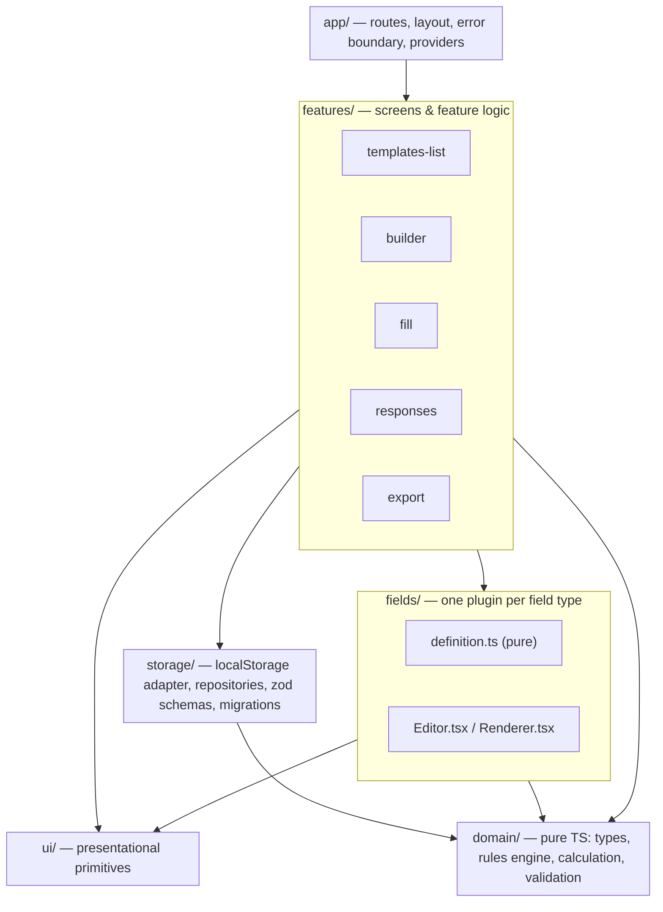
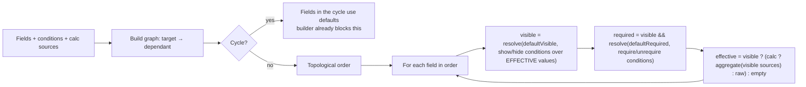

# Form Builder — High-Level Design

- **Status:** Draft, in review. Q-1 and Q-3 are resolved. Implementation follows [`implementation-plan.md`](implementation-plan.md), slice by slice.
- **Date:** 2026-10-31 (updated 2026-11-01)
- **Source:** _Form Builder — Frontend Take-Home Assignment_ (PDF)

This document sets out the shape of the system before any code is written: what we are building, how the pieces fit, how data is modelled and stored, the interfaces between modules, and what we optimise for. Decisions marked **D-n** become ADRs in `docs/decisions/` once approved. Questions marked **Q-n** are still open, and each one has a recommendation.

---

## 1. Requirements

### 1.1 Functional

| Area | Requirement |
| --- | --- |
| Templates list (home) | Lists all templates. Each card shows title, description (when set, D-32), field count, submitted-response count, in-progress draft count and last-modified date. Actions: _New Template_, open in Builder, _New Response_. |
| Builder mode | Left: field palette (add by click or drag). Centre: ordered canvas with reordering. Right: config panel for the selected field. The heading shows the template's title with an edit button that opens a dialog for the title and description. _Save_ writes to `localStorage`. _Preview_ opens Fill mode in a modal. |
| Fill mode | Shows the form title and description, then renders every field from its config. Conditional visibility and calculations update in real time. Required fields are validated on submit, and hidden fields are never validated. _Submit_ persists the response. _Download PDF_. |
| Responses list | Per template: an _In progress_ section of drafts (last edited, _Resume_, _Discard_), then submitted responses (submission timestamp, _Re-download PDF_). See D-23. |
| PDF export | Browser-native APIs only. Contains the form title, submission timestamp, and every **visible** field label and value, in form order. |
| Persistence | All data lives in `localStorage`. The app works after a full refresh, so every view is reachable by URL. |

**Field types.** The spec lists "10 field types", but #9 (Conditional Logic) is a capability every field has, not a field type. So the system has **9 field types plus a rules engine**:

| # | Type | Captures a value? | Can be a condition target? | Can be required? |
| --- | --- | --- | --- | --- |
| 1 | Single-line text | `string` | yes (text operators) | yes |
| 2 | Multi-line text | `string` | yes (text operators) | yes |
| 3 | Number | `number` | yes (number operators) | yes |
| 4 | Date | `IsoDate` | yes (date operators) | yes |
| 5 | Single select (radio / dropdown / tiles) | `OptionId` | yes (choice operators) | yes |
| 6 | Multi select | `OptionId[]` | yes (multi-choice operators) | yes |
| 7 | File upload | `FileMeta[]` | no (not in the operator table) | yes |
| 8 | Section header | none (display only) | no | no |
| 10 | Calculation | derived `number` (read-only) | no (not in the operator table) | no |

### 1.2 Non-functional

| Concern | Target | How the reviewer will check it |
| --- | --- | --- |
| Extensibility | Adding an 11th field type means adding **one folder and two registry lines**, with no other existing files edited. | "Can someone add an 11th field type without editing 6 existing files?" |
| Type safety | Strict TypeScript, no `any`. The types carry the design: discriminated unions, branded IDs, exhaustive switches. | "Do your types communicate the design, or are they decorative?" |
| Rules correctness | Chained conditions, hidden-but-required fields, and real-time updates. | Explicitly called out in the evaluation criteria. |
| Accessibility | WCAG 2.2 AA. Everything works by keyboard alone, and announcements go through a live region. | `AGENTS.md` |
| Production readiness | Loading, empty and error states. Input validated at the storage boundary. No debug code. | `AGENTS.md` |
| PDF quality | Looks like a real export, not a debug dump. | Evaluation criteria |
| Docs | README (run, storage schema, decisions, improvements), AI usage log, ADRs. | Submission checklist |

### 1.3 Out of scope (deliberately)

Multi-user collaboration, real file upload, template versioning UI, undo/redo, i18n, theming, list virtualisation, nested condition groups (D-1). Each is noted under "With more time" in the README.

---

## 2. Gaps in the spec and the product decisions we propose for them

The spec asks us to decide the ambiguous 10–20% ourselves and to document the reasoning. These are the decisions I propose, and the ones that need your sign-off are flagged.

### 2.1 Conditional logic

| # | Gap | Proposal | Reason |
| --- | --- | --- | --- |
| D-1 | AND or OR when a field has several conditions **(Q-1, resolved)** | Conditions are grouped by effect: each field has a _show_ and a _hide_ group, and input fields also have _require_ and _not-require_ groups. **Each group has its own `match: 'all' \| 'any'`**, defaulting to `all`. Groups are flat; nested groups such as `(A and B) or (C and D)` are not supported. | With only `equals` on single select, "show if reason = A **or** B" is impossible under AND-only. A single `match` per field is not enough either: "show if type = Travel **or** Meals" and "require if amount > 50 **and** payment = Cash" on the same field need different settings. Nested groups would cover every case, but their cost is in the builder UI, its accessibility and testing, not the engine. The shape extends to nesting later without breaking stored data, because a flat list is a valid nested one. |
| D-2 | Conflicting effects (the _show_ and _hide_ groups are both active) | **Hide beats show**, and **require beats not-require**. | Hiding fails closed: when the rules are ambiguous, collect less data. Requiring fails safe: when unsure, the field is not left optional. The builder shows a warning when a field has opposing effects. |
| D-3 | A group whose effect equals the default (for example _show_ on a field that is visible by default) | It has no effect. The builder flags it as a no-op. | This follows directly from the spec: the default applies when no condition is active. |
| D-4 | Target field is empty | The condition is **inactive**, for every operator, including `does not equal` and `contains none of`. | The spec says the default state applies "when the target field has no value". |
| D-5 | Chained conditions (A → B → C) where B is hidden | A hidden field's **effective value is empty**, so conditions that read it are inactive and C falls back to its default. Fields are evaluated in **topological order**. | This gives correct chaining in a single pass with no fixed-point iteration. |
| D-6 | Cycles (A depends on B, B depends on A) | The builder refuses any condition that would create a cycle: such targets are disabled in the picker, with the reason shown. The engine is also defensive and treats a field in a cycle as default. | Cycles have no well-defined meaning. Preventing them at authoring time beats resolving them at runtime. |
| D-7 | Text comparison semantics | Trimmed and case-insensitive. | Users do not expect `"Yes"` ≠ `"yes "`. |
| D-8 | `is within range` | Inclusive on both ends. The builder enforces `min ≤ max`. | This is the least surprising reading. |
| D-9 | A hidden field's value | Kept in the in-memory draft, so un-hiding restores what the user typed. It is **stripped** from the submitted record and the PDF, and it is excluded from calculations. | This meets the spec's rule and avoids destroying user input. |

### 2.2 Fields and data

| # | Gap | Proposal |
| --- | --- | --- |
| D-10 | Editing a template after responses exist | Each submitted response stores a **snapshot** of the template title, description and the visible fields it was answered against. Re-downloading a PDF always reproduces what was submitted. |
| D-11 | Select values | Values store a stable `OptionId`, never the label, so renaming an option does not break conditions or past responses. |
| D-12 | Deleting a field that other fields reference | A confirmation dialog lists the dependants. On confirm, the conditions and calculation sources that point at the field are removed. If a calculation is left with no sources, it becomes a save-blocking config error. |
| D-13 | Changing a field's type | Not supported. You delete the field and add a new one. This keeps each field's config and value types fixed for its lifetime. |
| D-14 | Calculation with empty sources | Empty or hidden sources are ignored, and Average divides by the count of filled sources. If every source is empty, the result is empty (shown as "—"), never `0`. |
| D-15 | Number decimals | Extra decimals are a validation error, not silently rounded. The input is `type="text"` with `inputMode="decimal"`, which avoids `type="number"`'s scroll-wheel changes and acceptance of `e`. |
| D-16 | Date storage | A plain `YYYY-MM-DD` string in **local** time. "Pre-fill today" uses the local date, never `toISOString()`, which returns the UTC date and is off by one day across midnight. String comparison then gives correct ordering. |
| D-17 | File types | The comma-separated input is normalised (`PDF` → `.pdf`, MIME wildcards like `image/*` allowed). Files are checked on change as well as via `accept`, because `accept` is only a hint. |
| D-18 | Section header levels | Form title is `h1`. XL→`h2`, L→`h3`, M→`h4`, S→`h5`, XS→`h6`, as the spec asks. The builder gives a non-blocking hint when a header skips a level. |
| D-19 | Field count on a card | Counts every field, section headers included. The label says "5 fields". | The spec asks for the "number of fields" and lists Section Header as one of its ten field types. The count then matches what the author sees on the canvas, and the UI says "field" everywhere, never "question", since a section header or a calculation asks nothing. |
| D-20 | Template with no fields | Can be saved. _New Response_ is disabled, with a reason. |
| D-21 | Unsaved builder changes | Navigating away (in-app or by closing the tab) prompts when there are unsaved changes. |
| D-22 | Deleting a template | Supported, with a confirmation that states how many submitted and in-progress responses will be deleted along with it. |
| D-23 | Drafts, refresh during filling, and resuming later **(Q-3, resolved)** | _New Response_ opens `/templates/:id/respond` with a draft held in memory. On the user's **first input** the draft is saved and the URL is replaced with the draft's own URL, then it autosaves with a debounce. A pre-filled date does not count as input, so abandoned clicks leave nothing behind. Drafts are listed under **In progress** on the responses page (last edited, _Resume_, _Discard_ with confirmation), and the card shows "12 responses · 2 in progress". Submitted counts and the submitted list stay as the spec defines them. A resumed draft is evaluated against the **current** template: values for deleted fields or options count as empty, and a notice says the form changed since the draft was started. Only submitted responses export to PDF, because the PDF carries a submission timestamp. | Saving drafts protects input from a refresh, but a draft nothing links to is lost in practice and stays in storage forever. Listing drafts is what makes resuming possible. |
| D-32 | Template description | An optional plain-text description (up to 500 characters; empty string means none). It shows on the card (clamped to two lines, omitted when empty), under the title in Fill mode, and in the PDF header when set. It is part of the response snapshot (D-10). It is edited, with the title, in a dialog opened from the edit button beside the builder's heading ([ADR 0009](decisions/0009-template-details-in-a-dialog.md)). | It tells the respondent what the form is for and helps tell templates apart. Plain text avoids rendering user markup. |
| D-33 | Builder work lost to a crash or a closed tab | Unsaved builder edits are mirrored, debounced, to a recovery copy. Reopening the builder when a copy is newer than the saved template offers _Restore_ or _Discard_. _Save_ clears the copy. A never-saved template is kept under the key `new`, so one unsaved new template can be recovered at a time. Lower priority: built in the polish phase if time allows. | D-21 only warns on navigation. _Save_ stays the explicit step that changes the template others fill in, so recovery never edits the real template. |
| D-34 | Saving a template with no title | Not allowed: _Save_ shows "Give the form a title." | The title heads the card, the Fill page and the PDF, which the spec requires to carry it. A blank one would leave all three without a name. |
| D-35 | Saving a field with no label | Not allowed: _Save_ shows "Give this field a label." on that field. | Respondents, screen readers and the PDF all need the field's words. This matches how other config errors already block _Save_. |

---

## 3. Architecture

### 3.1 Stack

| Concern | Proposal | Main alternative | ADR |
| --- | --- | --- | --- |
| Build | Vite + React 19 + TypeScript (`strict`, `noUncheckedIndexedAccess`) | Next.js, which brings SSR we cannot use with `localStorage` | D-24 |
| Routing | React Router (data router, `HashRouter`-style so it runs on any static host) | Hand-rolled view state, which breaks refresh and deep links | D-25 |
| State | `useReducer` for the builder, a pure engine + `useMemo` for fill, `useSyncExternalStore` over the storage repositories | Zustand or Redux, whose global stores this app does not need | D-26 |
| Boundary validation | `zod` schemas for everything read from `localStorage` | Hand-written type guards, which are verbose and drift from the types | D-27 |
| Drag and drop | `@dnd-kit/sortable`, which has a keyboard sensor and screen-reader announcements, **plus** move up/down buttons | Native HTML5 DnD, which is not keyboard accessible | D-28 |
| Styling | CSS Modules + design tokens as CSS custom properties | Tailwind, which gets noisy in JSX the reviewer has to read | D-29 |
| PDF | Print-optimised document in a hidden iframe → `print()` **(Q-2)** | A hand-written PDF byte generator | D-30 |
| Testing | Vitest + Testing Library + user-event + `vitest-axe`. One Playwright smoke test (optional). | Jest, which is slower and needs extra config under Vite | D-31 |
| Lint | ESLint (`typescript-eslint` strict, `jsx-a11y`, `react-hooks`) + Prettier | — | — |

### 3.2 Layers

Dependencies point **downward only**. The domain layer is plain TypeScript with no React, so the hardest logic (rules, calculations, validation) can be tested without rendering anything.



### 3.3 Folder structure

```
src/
  app/                 router, AppShell, RouteErrorBoundary, NotFound
  domain/
    ids.ts             branded ID types and factories
    template.ts        FormTemplate, Field union, FieldLogic
    response.ts        FormResponse, SubmittedAnswer
    rules/             condition operators, dependency graph, evaluate()
    calculation/       aggregate()
    validation/        validateResponse(), ValidationIssue codes
  fields/
    registry.ts        pure registry: type → FieldDefinition
    ui-registry.ts     type → { Editor, Renderer }, exhaustively typed
    text/              definition.ts, TextEditor.tsx, TextRenderer.tsx, *.test.ts(x)
    textarea/ number/ date/ single-select/ multi-select/ file/ section-header/ calculation/
  features/
    templates-list/    TemplatesPage, TemplateCard, useTemplates
    builder/           BuilderPage, builderReducer, FieldPalette, Canvas, ConfigPanel,
                       ConditionEditor, PreviewDialog, useUnsavedChangesGuard
    fill/              FillPage, FormRenderer, useFormRuntime, ErrorSummary
    responses/         ResponsesPage, ResponseRow
    export/            toExportModel(), PrintDocument, printDocument()
  storage/             localStore.ts, templateRepository.ts, responseRepository.ts,
                       schemas.ts, migrations.ts
  ui/                  Button, IconButton, Dialog, TextInput, Select, Checkbox, Switch,
                       FormField (label/hint/error wiring), LiveRegion, VisuallyHidden, EmptyState
  styles/              tokens.css, reset.css, print.css
```

### 3.4 Routes

| Path | Screen | States handled |
| --- | --- | --- |
| `/` | Templates list | empty ("Create your first template"), storage error |
| `/templates/new` | Builder with an unsaved blank template. After the first save, the URL is replaced with the edit URL. | — |
| `/templates/:templateId/edit` | Builder | not found, storage error |
| `/templates/:templateId/responses` | Responses list: in-progress drafts, then submitted responses | empty, not found |
| `/templates/:templateId/respond` | Fill mode with an unsaved draft. On first input, the URL is replaced with the draft's URL (D-23). | not found, template has no fields |
| `/templates/:templateId/responses/:responseId` | Fill mode for a saved draft (resume). A submitted response opens read-only. | not found, template deleted, template changed since the draft started |
| `*` | Not found | — |

`localStorage` reads are synchronous, so these views never show a "loading" state. The async work that does show progress is PDF preparation, which gets a busy state on the button.

---

## 4. Data model

### 4.1 Identity

```ts
type Brand<T, B extends string> = T & { readonly __brand: B };
type TemplateId = Brand<string, 'TemplateId'>;
type FieldId    = Brand<string, 'FieldId'>;
type OptionId   = Brand<string, 'OptionId'>;
type ResponseId = Brand<string, 'ResponseId'>;
type IsoDate     = Brand<string, 'IsoDate'>;     // YYYY-MM-DD, local
type IsoDateTime = Brand<string, 'IsoDateTime'>; // full ISO-8601, UTC
```

TypeScript compares types by shape, so `type FieldId = string` is only another name for `string`, and any string, or any other ID, can be passed as one. A brand intersects the string with a property that exists only in the type checker. A plain string lacks it, and `FieldId` and `OptionId` carry different brand names, so neither can stand in for the other. At runtime the value is still a plain string: no wrapper, no cost, and JSON, `===` and `Record` keys work unchanged.

```ts
removeOption(field, condition.targetFieldId);   // without brands this compiles; with them it is a type error
```

Branded values come only from code that can vouch for them: the factories in `ids.ts` (`crypto.randomUUID()` plus the module's one cast, and `toIsoDate(localDate)`), and zod's `.brand()` when reading `localStorage` or URL params. So a `:templateId` from the URL cannot be used until it has been parsed. Two bugs this rules out here: swapping a condition's `targetFieldId` with its `OptionId` value (both are UUIDs, so test fixtures would not notice), and passing `toISOString()` output (a UTC date-time) where a local `IsoDate` is expected, which is the off-by-one-day bug in D-16.

### 4.2 Template and fields

The `Field` union is **discriminated on `type`**. Every switch over it is exhaustive, ending in a `never` check, so a new type surfaces as a compile error everywhere it must be handled.

```ts
interface FormTemplate {
  id: TemplateId;
  title: string;
  description: string;        // plain text, '' = none (D-32)
  fields: Field[];            // array order = form order
  createdAt: IsoDateTime;
  updatedAt: IsoDateTime;
}

interface FieldBase<T extends string, C> {
  id: FieldId;
  type: T;
  label: string;
  config: C;
  logic: FieldLogic;
}

// One group per effect, each with its own AND/OR (D-1).
interface ConditionGroup {
  match: 'all' | 'any';
  conditions: Condition[];
}

// Display-only fields (section header, calculation) have no `required` axis,
// so they have no require/unrequire groups. That rule is encoded in the type,
// not checked at runtime.
interface FieldLogic {
  defaultVisible: boolean;
  show: ConditionGroup;
  hide: ConditionGroup;
}
interface InputFieldLogic extends FieldLogic {
  defaultRequired: boolean;                    // the spec's "Required toggle"
  require: ConditionGroup;
  unrequire: ConditionGroup;
}

type TextField        = FieldBase<'text',     TextConfig>      & { logic: InputFieldLogic };
type NumberField      = FieldBase<'number',   NumberConfig>    & { logic: InputFieldLogic };
// ...one per type
type SectionHeaderField = FieldBase<'section', { size: 'xs' | 'sm' | 'md' | 'lg' | 'xl' }>;
type CalculationField   = FieldBase<'calculation', {
  sourceFieldIds: FieldId[];                   // validated: Number fields only
  aggregation: 'sum' | 'average' | 'min' | 'max';
  decimals: 0 | 1 | 2 | 3 | 4;
}>;

type Field = TextField | TextareaField | NumberField | DateField | SingleSelectField
           | MultiSelectField | FileField | SectionHeaderField | CalculationField;
```

Representative configs:

```ts
interface TextConfig     { placeholder: string; minLength?: number; maxLength?: number; prefix: string; suffix: string }
interface NumberConfig   { min?: number; max?: number; decimals: 0 | 1 | 2 | 3 | 4; prefix: string; suffix: string }
interface DateConfig     { prefillToday: boolean; minDate?: IsoDate; maxDate?: IsoDate }
interface Option         { id: OptionId; label: string }
interface SingleSelectConfig { options: Option[]; display: 'radio' | 'dropdown' | 'tiles' }
interface MultiSelectConfig  { options: Option[]; minSelections?: number; maxSelections?: number }
interface FileConfig     { allowedTypes: string[]; maxFiles?: number }
```

### 4.3 Conditions: the operator is typed by the kind of value it reads

Operators are grouped by **value kind**, not by field type. A future "Email" field whose value kind is `text` gets the text operators without any rules-engine changes.

```ts
type Predicate =
  | { kind: 'text';   op: 'equals' | 'notEquals' | 'contains'; value: string }
  | { kind: 'number'; op: 'equals' | 'gt' | 'lt';              value: number }
  | { kind: 'number'; op: 'between';                            value: { min: number; max: number } }
  | { kind: 'choice'; op: 'equals' | 'notEquals';               value: OptionId }
  | { kind: 'multi';  op: 'containsAny' | 'containsAll' | 'containsNone'; value: OptionId[] }
  | { kind: 'date';   op: 'equals' | 'before' | 'after';        value: IsoDate };

interface Condition {
  id: string;
  targetFieldId: FieldId;   // never the owning field (enforced by the builder + schema refinement)
  predicate: Predicate;
}
```

A condition takes its effect (show, hide, require or not-require) from the group it belongs to, which is how the spec's per-condition _Effect_ is represented. The builder reads as a sentence per group: "Show this field when [all ▾] of these match".

### 4.4 Responses

```ts
type FieldValue =
  | { kind: 'text';   value: string }
  | { kind: 'number'; value: number | null }
  | { kind: 'date';   value: IsoDate | null }
  | { kind: 'choice'; value: OptionId | null }
  | { kind: 'multi';  value: OptionId[] }
  | { kind: 'files';  value: FileMeta[] };

interface FileMeta { name: string; size: number; type: string; lastModified: number }

interface DraftResponse {
  status: 'draft';
  id: ResponseId;
  templateId: TemplateId;
  values: Partial<Record<FieldId, FieldValue>>;   // raw input, including hidden fields (D-9)
  createdAt: IsoDateTime;
  updatedAt: IsoDateTime;
}

interface SubmittedResponse {
  status: 'submitted';
  id: ResponseId;
  templateId: TemplateId;
  submittedAt: IsoDateTime;
  snapshot: { title: string; description: string; fields: Field[] };   // D-10: what the user actually saw
  answers: Partial<Record<FieldId, FieldValue>>; // visible fields only, calculations resolved
}

type FormResponse = DraftResponse | SubmittedResponse;
```

Tagging each value with its `kind` lets the engine and the PDF narrow it safely, and lets the zod schema reject a value that does not match its field.

### 4.5 `localStorage` schema

```
formBuilder:v1:templates   →  { schemaVersion: 1, items: Record<TemplateId, FormTemplate> }
formBuilder:v1:responses   →  { schemaVersion: 1, items: Record<ResponseId, FormResponse> }
formBuilder:v1:recovery    →  { schemaVersion: 1, items: Record<TemplateId | 'new', FormTemplate> }   // D-33
```

| Choice | Reasoning |
| --- | --- |
| Two collection keys, not one key per entity | Listing all templates takes one read, and response counts per template take one read. At the expected scale (tens of templates, hundreds of responses), rewriting a whole collection is cheap. The repository interface hides this, so moving to IndexedDB later only means swapping the adapter. |
| Not one key for everything | Saving a template would otherwise re-serialise every response. |
| `Record` keyed by ID, not an array | O(1) lookup and update, with no duplicates. |
| A `schemaVersion` envelope | `migrations.ts` upgrades old shapes on read. Without the version there is no safe way to evolve the shape. |
| zod parse on every read | Data in storage is untrusted (user edits, old versions, other tabs). If parsing fails, the raw value is copied to `formBuilder:quarantine:<timestamp>` and an error state is shown. We **never silently wipe** user data. |
| `QuotaExceededError` handling | Writes return a result type. The UI shows "Storage is full" and keeps the in-memory state so no work is lost. |
| Cross-tab | A `storage` event invalidates the in-memory cache. On save, the builder compares `updatedAt` and warns if another tab saved in the meantime (last write wins, but never silently). |

---

## 5. Interfaces between modules

### 5.1 Field plugin contract (the extensibility seam)

Each field type is one folder. The pure half is registered in `fields/registry.ts`. The React half is registered in `fields/ui-registry.ts`, whose type is `{ [K in FieldType]: FieldUi<K> }`, so **forgetting the UI for a new type is a compile error**.

```ts
interface FieldDefinition<F extends Field> {
  type: F['type'];
  paletteLabel: string;
  paletteIcon: IconName;
  valueKind: ValueKind | null;                 // null = display-only
  create(id: FieldId): F;                      // defaults for a newly added field
  configSchema: z.ZodType<F['config']>;        // boundary validation
  validateConfig(field: F, ctx: TemplateContext): ConfigIssue[];       // builder errors
  initialValue(field: F, now: Date): FieldValue | undefined;          // e.g. date prefill
  validateValue(field: F, value: FieldValue | undefined, required: boolean): ValueIssue[];
  formatForExport(field: F, value: FieldValue | undefined): ExportValue; // PDF
}

interface FieldUi<K extends FieldType> {
  Editor:   ComponentType<{ field: FieldOf<K>; context: TemplateContext; onChange(next: FieldOf<K>): void }>;
  Renderer: ComponentType<{ field: FieldOf<K>; value: FieldValueOf<K> | undefined; required: boolean;
                            error?: ValueIssue; readOnly?: boolean; onChange(v: FieldValueOf<K>): void }>;
}
```

**Adding an 11th type:** create `fields/<new>/` (definition, editor, renderer, tests), then add one line to each registry and one member to the `Field` union. Builder, Fill, PDF, validation and conditions need no changes.

### 5.2 Builder state

The builder state is a pure reducer, so every editing rule can be unit-tested without rendering.

```ts
type BuilderAction =
  | { type: 'template/loaded'; template: FormTemplate }
  | { type: 'title/changed'; title: string }
  | { type: 'description/changed'; description: string }
  | { type: 'field/added'; fieldType: FieldType; atIndex?: number }
  | { type: 'field/updated'; field: Field }
  | { type: 'field/removed'; fieldId: FieldId }      // cascades references (D-12)
  | { type: 'field/moved'; fieldId: FieldId; toIndex: number }
  | { type: 'field/selected'; fieldId: FieldId | null }
  | { type: 'template/saved'; savedAt: IsoDateTime };

interface BuilderState { template: FormTemplate; selectedFieldId: FieldId | null; savedSnapshot: FormTemplate }
// Derived, not stored: isDirty, configIssues (blocks Save), dependants(fieldId), allowedTargets(fieldId)
```

### 5.3 Rules engine (pure)

```ts
function buildDependencyGraph(fields: Field[]): DependencyGraph;   // memoised per template
function evaluateForm(template: FormTemplate, graph: DependencyGraph,
                      values: ResponseValues): FormEvaluation;

interface FormEvaluation {
  visible:   ReadonlySet<FieldId>;
  required:  ReadonlySet<FieldId>;
  computed:  ReadonlyMap<FieldId, number | null>;   // calculation results
  effective: ResponseValues;                         // hidden → empty, calculations filled in
}
```

The algorithm runs in one pass, in topological order:



How one axis is resolved, using visibility as the example:

```
active(group) = group.conditions.length > 0 &&
  (group.match === 'all' ? group.conditions.every(holds) : group.conditions.some(holds))
visible = defaultVisible
  ? !active(logic.hide)
  : active(logic.show) && !active(logic.hide)               // hide beats show (D-2)
holds(c) = target is non-empty && predicate(c, effective[target])   (D-4)
```

### 5.4 Fill runtime hook

```ts
function useFormRuntime(template: FormTemplate, draft: DraftResponse): {
  evaluation: FormEvaluation;
  setValue(fieldId: FieldId, value: FieldValue): void;
  submit(): { ok: true; response: SubmittedResponse } | { ok: false; issues: ValueIssue[] };
  issues: ReadonlyMap<FieldId, ValueIssue>;   // shown after the first submit attempt
};
```

Validation runs **on submit**, as the spec says. After the first failed submit, fields re-validate as they change, so the user sees an error clear as soon as they fix it.

### 5.5 Storage repositories

```ts
interface TemplateRepository {
  list(): Result<TemplateSummary[], StorageError>;   // summary includes fieldCount, responseCount, draftCount
  get(id: TemplateId): Result<FormTemplate | null, StorageError>;
  save(t: FormTemplate): Result<void, StorageError>;
  remove(id: TemplateId): Result<void, StorageError>;  // also removes its responses (D-22)
  subscribe(listener: () => void): () => void;         // for useSyncExternalStore
}
// ResponseRepository has the same shape, plus listSubmitted(templateId) and listDrafts(templateId).
```

### 5.6 Export

```ts
function toExportModel(response: SubmittedResponse): ExportDocument;  // pure and fully unit-tested
function printDocument(doc: ExportDocument): Promise<void>;           // the thin DOM/iframe side effect
```

`ExportDocument` contains the title, the description, `submittedAt`, and an ordered list of `{ kind: 'section', text, level } | { kind: 'answer', label, display: string | string[] }`. It is built from the **snapshot**, so hidden fields are already absent.

---

## 6. PDF export (Q-2)

"Browser-native APIs only" leaves two real options:

| | A. Print document + `window.print()` (recommended) | B. Hand-written PDF bytes → `Blob` download |
| --- | --- | --- |
| How it works | Render `PrintDocument` into a hidden `<iframe>` with a print stylesheet (`@page` size and margins, running header, `break-inside: avoid` per answer), then call `iframe.contentWindow.print()`. The user picks "Save as PDF". `document.title` sets the file name. | Write the PDF object model by hand (catalog, pages, Helvetica text objects, xref), with our own line wrapping and pagination, then download it through an object URL. |
| Output quality | Best: real typography, selectable text, full Unicode, layout in CSS. | Basic: standard-14 fonts only, so no characters outside WinAnsi (emoji, CJK) unless we embed a font. |
| UX | Goes through the print dialog, so the download is not one click. | A true one-click download. |
| Cost and risk | Low. About 150 lines plus CSS. | High. About 500+ lines covering text measurement, wrapping, pagination and escaping. |
| Testability | `toExportModel` is pure. The print view can be snapshot- and axe-tested. | Byte output is hard to assert on beyond structure. |

**Recommendation: A.** The spec rewards output that "looks like a real export", and A produces a better-looking document in a fraction of the time. The print-dialog step goes in the README as a known trade-off, and B goes under "with more time".

Export layout: a header with the form title, the description when set, "Submitted 31 Oct 2026, 14:05" and the response ID. Section headers become typographic sections. Each answer is a label/value pair. Unanswered optional fields show "Not answered" in muted text. Numbers keep their prefix and suffix and use `Intl.NumberFormat` with the configured decimals. Dates use a long locale format. Multi-select answers are a list. Files appear as `name · 2.4 MB · PDF` with a footnote: _"Attachments are listed by name only; file contents are not included in this export."_ Page numbers go in the footer.

---

## 7. Accessibility plan (WCAG 2.2 AA)

| Area | Approach |
| --- | --- |
| Reordering | dnd-kit keyboard sensor (Space to lift, arrows to move, Space to drop) with spoken announcements, **plus** Move up/down buttons on every canvas item. The buttons satisfy **2.5.7 Dragging Movements**, which requires a single-pointer alternative to dragging. |
| Palette | Real `<button>`s: click or Enter adds the field after the current selection. Focus moves to the new field, and "Short text added at position 4" is announced. |
| Canvas selection | Each item is a button with `aria-pressed`. The config panel is a labelled `<section>`, and focus can move into it. |
| Form semantics | Every control is wrapped by `FormField`, which wires up `<label>`, hint and error through `aria-describedby`, plus `aria-invalid`. Radio, tile and multi-select groups use `<fieldset>`/`<legend>`. Tiles are native radios styled as cards, so behaviour and accessibility match the radio and dropdown displays exactly. Dropdown is a native `<select>`. Date is a native `<input type="date">`. |
| Required | The visible "Required" marker is paired with the `required` / `aria-required` attributes. |
| Prefix and suffix | Rendered as adornments and included in the input's accessible description. |
| Calculation | A read-only `<output>`, associated with its label, that names its sources. |
| Submit errors | An error summary at the top gets focus. Each error is a link that jumps to its field (the GOV.UK pattern). |
| Dynamic changes | One polite live region announces when fields are shown or hidden ("2 fields added below"), when the builder saves, and when a field is added or moved. Announcements are batched so typing never floods a screen reader. |
| Dialogs | Template details (v0.1) and Preview use `ui/Dialog`: a native `<dialog>` with `showModal()`, which gives a focus trap and Escape to close. `Dialog` returns focus to the trigger itself, falling back to a named element when the trigger has gone. |
| Other | A visible `:focus-visible` ring with at least 3:1 contrast, 24×24 px minimum targets (2.5.8), focus never hidden behind sticky panels (2.4.11), `prefers-reduced-motion` respected, and a focus/title update on every route change. |

---

## 8. Optimisations

The goal is correctness first. Each of these is cheap and has a measurable reason; none is speculative.

| Concern | Optimisation |
| --- | --- |
| Rules evaluation per keystroke | The dependency graph and topological order are memoised per template. `evaluateForm` is O(fields + conditions) and returns new objects only for fields that changed. |
| Re-renders while typing | `FieldRenderer` is `React.memo`'d and receives primitives (`value`, `visible`, `required`, `error`) plus a stable `onChange` bound to its field ID. A keystroke re-renders the edited field and its dependants, not the whole form. |
| Storage reads | Repositories keep a parsed in-memory cache. `useSyncExternalStore` snapshots are referentially stable. The cache is invalidated on write and on the `storage` event, and nothing calls `JSON.parse` during render. |
| Storage writes | Draft autosave starts on first input, is debounced (about 400 ms) and is flushed on `pagehide` and `visibilitychange`. Templates are saved only on an explicit _Save_; the builder's recovery copy (D-33) uses the same debounce and flush. |
| Bundle | Routes are code-split with `React.lazy`, so dnd-kit loads only in the builder and the print view only on export. The dependency budget is kept small: react-router, zod, dnd-kit. |
| Builder canvas | The config panel only renders the selected field's editor, and canvas items render compact summaries rather than full field previews. |
| Not doing | List virtualisation (forms will have well under 200 fields), web workers, or IndexedDB. These are noted as the scaling path in the README. |

---

## 9. Testing strategy

Tests are named by user scenario and assert on observable behaviour (see `AGENTS.md`).

| Layer | Examples |
| --- | --- |
| Domain: rules (most tests go here) | shows a field when its show condition matches · hide beats show when both match · a chained field falls back to default when its controlling field is hidden · empty target leaves the condition inactive for `does not equal` · `any` vs `all` matching · `any` on the show group and `all` on the require group of the same field resolve independently · cycle detection rejects A↔B |
| Domain: calculation | averages only filled sources · result is empty when every source is empty · hidden sources are excluded · rounds to the configured decimals |
| Domain: validation | hidden required field is not validated · min/max length, value, selections · decimals · file type and count |
| Storage | round-trips a template · quarantines corrupt JSON instead of wiping · migrates v0 → v1 · surfaces quota errors |
| Builder reducer | removing a field strips the conditions and calculation sources that reference it · moving a field keeps the selection |
| Field components | each renderer is queried by role and label · single select behaves identically in all three displays (parameterised test) |
| Feature flows | build → save → refresh → fill → submit → appears in the responses list · submit with missing required shows the error summary with focus · opening _New Response_ and leaving without input saves no draft · a started draft appears under In progress and resumes with its values · a resumed draft whose option was deleted treats that answer as empty · the builder offers to restore unsaved edits after a reload |
| Export | `toExportModel` omits hidden fields, keeps form order, and formats files as metadata with a footnote |
| a11y | `vitest-axe` on each page in its key states |

---

## 10. Delivery plan

Delivery follows [`implementation-plan.md`](implementation-plan.md): eleven thin end-to-end slices (v0.1 to v1.0), each one runnable in the browser and signed off at a verification gate before the next starts. It replaced a layer-by-layer plan (scaffold, domain, field plugins, screens), under which nothing could be checked in the browser until the last layer was done.

---

## 11. Open questions for review

| # | Question | Recommendation |
| --- | --- | --- |
| **Q-1** | How should multiple conditions combine? | **Resolved (D-1):** one flat group per effect, each with its own `all \| any` (default `all`), with hide-beats-show and require-beats-unrequire for conflicts. Nested groups are deferred. |
| **Q-2** | PDF approach | A: print document + `print()`. B (hand-written PDF bytes) goes under "with more time". |
| **Q-3** | Persist drafts while filling? | **Resolved (D-23):** yes, because we don't want to lose data. Drafts are saved on first input, autosaved, and listed under In progress so they can be resumed. |
| **Q-4** | Condition targets: any field, or only fields above? | Any field except itself, with cycle prevention. "Only fields above" removes cycles by construction, but reordering can then invalidate conditions. |
| **Q-5** | Library set | react-router, zod and @dnd-kit, with no state or UI library and CSS Modules for styling. |
